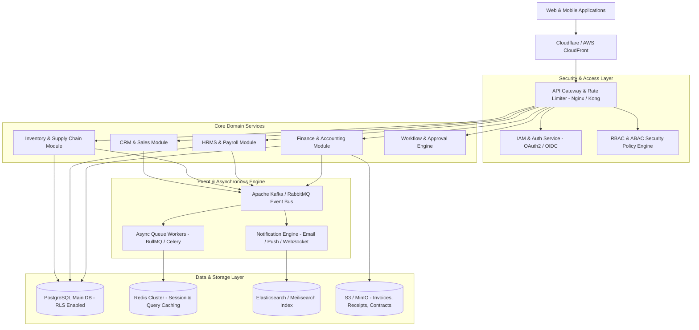
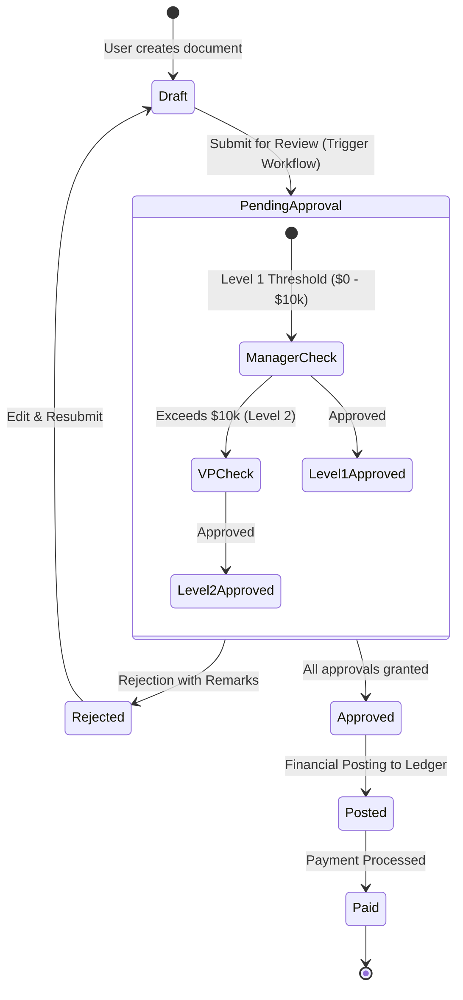
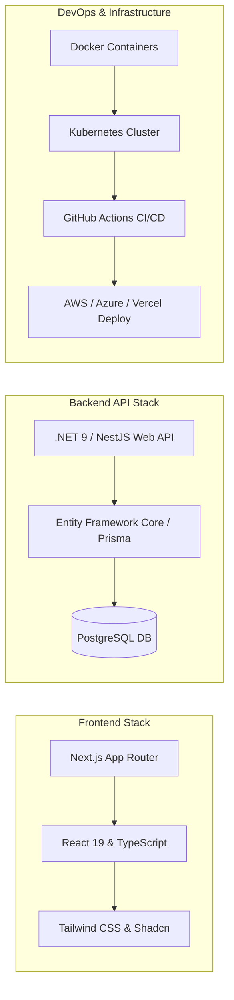

# 🏗️ Enterprise ERP Master Architecture & Production Blueprint (2026 SaaS Standard)

> **Document Status**: Production Architecture Specification  
> **Version**: 2.0.0  
> **Target System**: Scalable Multi-Tenant Enterprise SaaS ERP  

---

## 1. Executive Summary & Core Principles

This document defines the end-to-end architectural specification, UI/UX design standards, database schemas, security framework, and development lifecycle for building a high-performance Enterprise Resource Planning (ERP) platform.

### Core Architectural Principles:
1. **Strict Multi-Tenancy**: Data isolation guaranteed at database row and application middleware levels.
2. **Modular Architecture**: High cohesion within modules, low coupling between services (Modular Monolith evolving into Microservices).
3. **Auditability & Compliance**: Immutable audit trails for 100% of state-changing transactions.
4. **High-Density, Performance-Driven UI**: Optimized for power users with keyboard shortcuts (`Ctrl+K`), sub-100ms response times, and virtualized data grids.
5. **Stateful Workflow Engine**: Configurable approval matrices for financial and operational documents.

---

## 2. High-Level System Architecture



---

## 3. Database Strategy & Multi-Tenancy Architecture

### 3.1 Multi-Tenant Data Isolation Strategy
We utilize **Shared Database with PostgreSQL Row-Level Security (RLS)** as the primary strategy for mid-to-enterprise tiers, with support for **Schema-per-Tenant** for enterprise contracts.

```sql
-- Enable Row Level Security on Enterprise Tables
ALTER TABLE invoices ENABLE ROW LEVEL SECURITY;

-- Security Policy to enforce tenant isolation
CREATE POLICY tenant_isolation_policy ON invoices
    FOR ALL
    USING (tenant_id = current_setting('app.current_tenant_id'));
```

### 3.2 Core Database ERD Models (Prisma / EF Core Schema Blueprint)

#### Tenant & Authentication Schema
```prisma
model Tenant {
  id           String       @id @default(uuid())
  name         String
  code         String       @unique
  currency     String       @default("USD")
  timezone     String       @default("UTC")
  createdAt    DateTime     @default(now())
  users        User[]
  roles        Role[]
  invoices     Invoice[]
}

model User {
  id           String       @id @default(uuid())
  tenantId     String
  tenant       Tenant       @relation(fields: [tenantId], references: [id])
  email        String       @unique
  passwordHash String
  fullName     String
  isActive     Boolean      @default(true)
  userRoles    UserRole[]
  auditLogs    AuditLog[]
}

model Role {
  id           String       @id @default(uuid())
  tenantId     String
  name         String
  permissions  Permission[]
  userRoles    UserRole[]
}
```

#### Financial & Accounting Core Schema
```prisma
model Account {
  id           String       @id @default(uuid())
  tenantId     String
  accountCode  String
  name         String
  type         AccountType  // ASSET, LIABILITY, EQUITY, REVENUE, EXPENSE
  balance      Decimal      @default(0.00)
  currency     String
}

model Invoice {
  id           String        @id @default(uuid())
  tenantId     String
  tenant       Tenant        @relation(fields: [tenantId], references: [id])
  invoiceNo    String        @unique
  customerId   String
  totalAmount  Decimal
  taxAmount    Decimal
  status       InvoiceStatus // DRAFT, PENDING_APPROVAL, APPROVED, PAID, VOID
  dueDate      DateTime
  createdAt    DateTime      @default(now())
  items        InvoiceItem[]
}
```

#### Audit Log Schema (Immutable Ledger)
```prisma
model AuditLog {
  id           String   @id @default(uuid())
  tenantId     String
  userId       String
  user         User     @relation(fields: [userId], references: [id])
  action       String   // CREATE, UPDATE, DELETE, APPROVE
  entityName   String   // Invoice, Customer, JournalEntry
  entityId     String
  previousData Json?
  newData      Json?
  ipAddress    String
  timestamp    DateTime @default(now())

  @@index([tenantId, entityName, entityId])
}
```

---

## 4. Security Framework & Role-Based Access Control (RBAC)

Permissions follow the format: `<module>:<submodule>:<action>`

| Role | Permissions String | Data Scoping Boundary |
| :--- | :--- | :--- |
| **Super Admin** | `*:*:*` | All Tenants |
| **Finance Manager** | `finance:*:read`, `finance:invoice:approve`, `finance:journal:create` | Tenant Level |
| **Sales Rep** | `crm:lead:*`, `sales:order:create`, `sales:order:read` | Assigned Branch / Personal Records |
| **HR Specialist** | `hrms:employee:read`, `hrms:attendance:write` | Department Level |

---

## 5. Workflow Engine & Document State Machines

All critical financial documents (Purchase Orders, Invoices, Expenses) transition through a formal State Machine governed by customizable approval thresholds.



---

## 6. UI/UX Design System & Layout Architecture

### 6.1 Screen Layout & Component Blueprint
A modern enterprise ERP layout prioritizes **density**, **keyboard access**, and **context retention**:

```
+-----------------------------------------------------------------------------------------+
| [≡] ERP Portal  [🔍 Search Ctrl+K                ]  [🏢 Acme India v]  (🔔 3) (👤 Profile) |
+------------------+----------------------------------------------------------------------+
| NAVIGATION       | Breadcrumb: Home / Finance / Invoices                                |
| ---------------- | -------------------------------------------------------------------- |
| 📊 Dashboard     | PAGE HEADER: Vendor Invoices       [+ Create Invoice] [📥 Export]     |
| 💰 Finance    v  | -------------------------------------------------------------------- |
|   - Ledger       | [ KPI: Overdue $12.4K ] [ KPI: Paid $140K ] [ Pending Approval: 8 ] |
|   - Invoices     | -------------------------------------------------------------------- |
| 👥 HRMS       v  | FILTERS: [Status: All v] [Date: This Month v] [🔍 Search Invoices...] |
| 📦 Inventory  v  | -------------------------------------------------------------------- |
| 📈 Reports    v  | DATA TABLE (TanStack Virtualized Grid)                               |
| ⚙️ Settings   v  | [x] INV-ID   | Vendor       | Date       | Amount   | Status    | Action|
|                  | [ ] INV-1001 | Acme Corp    | 01-Aug-26  | $5,000   | [PAID]    | [...] |
|                  | [ ] INV-1002 | Globex Ltd   | 05-Aug-26  | $12,500  | [PENDING] | [...] |
|                  | -------------------------------------------------------------------- |
|                  | Page 1 of 12  [< Prev] [1] 2 3 [Next >]           Rows per page: [25v]|
+------------------+----------------------------------------------------------------------+
```

### 6.2 Frontend Technology Architecture
- **Framework**: Next.js 16 (App Router with React 19)
- **UI Library**: Tailwind CSS v4 + Radix UI / Shadcn UI components
- **Grid Engine**: TanStack Table v8 + `@tanstack/react-virtual` for handling 100,000+ data rows cleanly.
- **Form Management**: React Hook Form + Zod schema validation.
- **State Management**: TanStack Query v5 for API caching, Zustand for UI drawer/filter states.

---

## 7. Technology Stack & Deployment Architecture



---

## 8. Missing Architectural Enhancements Addressed

1. **Multi-Currency Engine**: Automated exchange rate fetching with base currency conversion at ledger level.
2. **Localization (i18n)**: RTL support, locale-specific date/number formats.
3. **Structured Error Protocol**: Implement RFC 7807 `Problem Details` for uniform API error responses.
4. **Disaster Recovery**: Automated point-in-time recovery (PITR) for PostgreSQL with 15-minute RPO.

---

## 9. Next Steps: Implementation & Build Sequence

1. **Phase 1: Foundation & Auth Setup**: Multi-tenant database migrations, JWT OAuth2 authentication, and layout shell.
2. **Phase 2: Core Finance Module**: Accounts, Ledger, Invoices CRUD, and workflow approvals.
3. **Phase 3: HRMS & Inventory Integration**: Employee master, Leave management, Item master, PO workflows.
4. **Phase 4: Analytics & Reporting**: Real-time KPI dashboards, PDF export engines, and audit log viewer.
