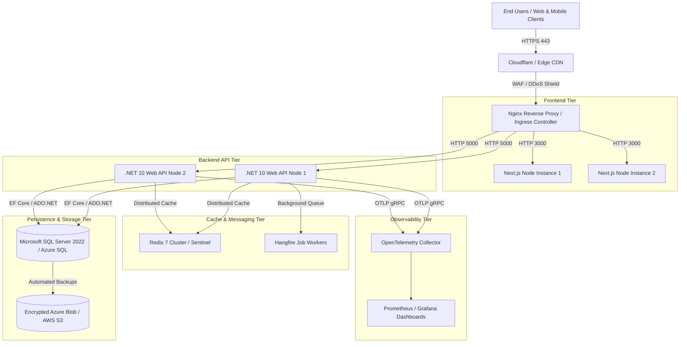

# UabIndia Enterprise Cloud ERP — Production Operations & Disaster Recovery Runbook
**Version:** 1.0.0-prod-ready  
**Classification:** Enterprise Internal Operations (DevSecOps / SRE / DBA)  
**Target Systems:** .NET 10 Web API, Next.js 15 Standalone Frontend, Microsoft SQL Server 2022 / Azure SQL, Redis 7 Cluster, Nginx / Cloudflare Ingress.

---

## 1. Production Architecture Topology



---

## 2. Master Database Deployment Guide (DBA Procedure)

### 2.1 Deployment Script
- **File**: `Backend/src/UabIndia.Infrastructure/Data/Migrations/Sql/Full_Production_Schema_v1.0.0.sql`
- **Engine Compatibility**: Microsoft SQL Server 2019+, Microsoft SQL Server 2022, Azure SQL Database.
- **Idempotency**: Wrapped in `[__EFMigrationsHistory]` transaction verification. Safe to execute on fresh empty databases or pre-existing databases without data loss.

### 2.2 Execution Steps via `sqlcmd` / SSMS:
```bash
# Execute using sqlcmd with encryption and trusted certificate:
sqlcmd -S "tcp:sql-uabindia-prod.database.windows.net,1433" \
       -d "uabindia_erp_db" \
       -U "uabadmin" \
       -P "<YOUR_SECURE_PASSWORD>" \
       -N -C \
       -i "Backend/src/UabIndia.Infrastructure/Data/Migrations/Sql/Full_Production_Schema_v1.0.0.sql"
```

### 2.3 Post-Migration Verification Query:
```sql
SELECT MigrationId, ProductVersion, AppliedAt = GETUTCDATE()
FROM [__EFMigrationsHistory]
ORDER BY MigrationId ASC;
```
*Expected Result: 20 rows verified.*

---

## 3. Cryptographic Secret Generation & Rotation SOP

### 3.1 Initial Secret Generation
Before launching production containers, execute the automated secret generator:
```powershell
# On Windows / PowerShell:
.\scripts\generate-production-secrets.ps1

# On Linux / Bash:
chmod +x ./scripts/generate-production-secrets.sh
./scripts/generate-production-secrets.sh
```

### 3.2 Secret Key Specifications:
1. **`Jwt__Secret`**: 512-bit Base64 string (64 random bytes). Rotated quarterly.
2. **`Encryption__MasterKey`**: 256-bit Base64 string (32 random bytes) for AES-256-GCM column encryption.
3. **`Encryption__HmacKey`**: 256-bit Base64 string (32 random bytes) for deterministic blind-index searching.

---

## 4. Zero-Downtime Blue/Green Deployment

### 4.1 Production Docker Compose Deployment
```bash
# 1. Pull latest verified release tag
git fetch --tags
git checkout tags/v1.0.0-prod-ready

# 2. Validate environment file permissions
chmod 600 .env.production

# 3. Build images and launch services in background
docker compose -f docker-compose.prod.yml --env-file .env.production up -d --build --remove-orphans

# 4. Verify container health status
docker compose -f docker-compose.prod.yml ps
```

### 4.2 Health Check Validation Endpoints:
- **Backend Liveness**: `GET https://api.uabindia.com/health/live` (Returns `200 OK`)
- **Backend Readiness**: `GET https://api.uabindia.com/health/ready` (Verifies SQL + Redis connectivity)
- **Frontend Liveness**: `GET https://uabindia.com/api/health` (Returns `200 OK`)

---

## 5. Multi-Tenant Backup & Disaster Recovery (DR)

### 5.1 Automated Full & Differential Backups
- **Full Database Backup**: Daily at `01:00 UTC` (7-year retention for statutory audit compliance).
- **Differential Backup**: Every 4 hours.
- **Transaction Log Backup**: Every 15 minutes (Point-in-Time Recovery with RPO < 15 min).

### 5.2 Manual On-Demand Backup Script:
```powershell
.\scripts\backup-database.ps1 -BackupType "Full" -Destination "AzureBlob"
```

### 5.3 Point-in-Time Disaster Recovery (RTO < 30 minutes):
```sql
-- Restore latest Full Backup
RESTORE DATABASE [uabindia_erp_db]
FROM DISK = 'C:\Backups\uabindia_full_20260902.bak'
WITH NORECOVERY, REPLACE;

-- Apply latest Differential Backup
RESTORE DATABASE [uabindia_erp_db]
FROM DISK = 'C:\Backups\uabindia_diff_20260902_1200.bak'
WITH NORECOVERY;

-- Roll forward Transaction Logs to point in time
RESTORE LOG [uabindia_erp_db]
FROM DISK = 'C:\Backups\uabindia_log_20260902_1215.trn'
WITH RECOVERY, STOPAT = '2026-09-02 12:14:00';
```

---

## 6. Observability & SRE Metrics

### 6.1 Prometheus Metrics Endpoint
- **Endpoint**: `GET /api/v1/telemetry/metrics` or `/metrics`
- **Key Metrics Exported**:
  - `uabindia_http_requests_total{status, endpoint, tenant}`: Total request rate.
  - `uabindia_http_request_duration_seconds`: Latency histogram (p50, p95, p99).
  - `uabindia_active_tenants_gauge`: Currently active tenant connections.
  - `uabindia_payroll_runs_completed_total`: Business event processing velocity.
  - `uabindia_db_connection_pool_active`: SQL connection saturation.

### 6.2 SRE Alerting Thresholds:
| Alert Rule | Condition | Severity | Action |
| :--- | :--- | :--- | :--- |
| **HighErrorRate** | 5xx HTTP Responses > 2% over 5m | **P0 (Critical)** | Page On-Call SRE; check DB connectivity & error logs. |
| **HighLatency** | p95 Latency > 1,500ms over 5m | **P1 (High)** | Check Redis cache hit ratio & SQL query locks. |
| **DbConnectionPoolExhaustion** | Active Connections > 85% of Max | **P1 (High)** | Scale API replicas or increase Max Pool Size. |
| **TenantIsolationBreachAttempt** | Mismatched Tenant ID / Claim Token | **P0 (Security)** | Block offending IP via Cloudflare WAF; trigger incident response. |

---

## 7. Incident Escalation Matrix

| Level | Response Time (SLA) | Primary Owner | Escalation Contact |
| :--- | :--- | :--- | :--- |
| **P0 (Outage / Security Breach)** | **< 15 minutes** | Lead SRE / Security Architect | CTO / Head of Engineering |
| **P1 (Degraded Performance / Core Module Blocked)** | **< 30 minutes** | Senior Backend Engineer | Lead SRE |
| **P2 (Non-Critical Bug / Minor UI Inconsistency)** | **< 4 hours** | Product Engineer | QA Lead |
