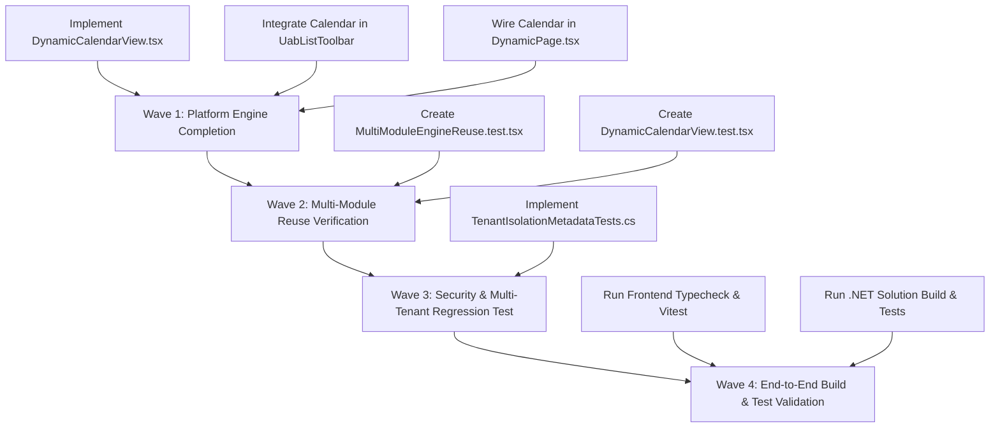

# 21 — Confirmed Defects, Missing Functionality, Technical Risks & Backlog Catalog

**Classification:** Enterprise ERP Forensic Gap Analysis & Execution Backlog  
**Standard Compliance:** UAB India Proprietary Enterprise Suite Architecture  
**Platform Stack:** .NET 10 / ASP.NET Core & Next.js 15 / React 19 / TypeScript  

---

## 1. Confirmed Defects

| ID | Title | Affected Files | Severity | Dependencies | Acceptance Criteria |
| :--- | :--- | :--- | :--- | :--- | :--- |
| **DEF-01** | Missing Calendar View Engine in Dynamic Suite | `frontend/src/components/dynamic/DynamicPage.tsx`, `frontend/src/components/uab/data-table/UabListToolbar.tsx` | **Medium** | `ErpViewMode`, `DynamicPageSchema` | Calendar mode can be selected from toolbar; renders monthly/weekly grid with events mapped from date/due-date fields without crashing. |
| **DEF-02** | Absence of Automated Multi-Module Dynamic Engine Equivalence Tests | `frontend/src/components/dynamic/__tests__/` | **Low** | `DynamicPage.tsx`, `DynamicForm.tsx`, `DynamicFieldRegistry.tsx` | Automated test suite passes asserting at least two genuinely distinct business modules (e.g. Administration vs Procurement/HRMS) render via identical dynamic engine components without duplicate code. |
| **DEF-03** | Lack of Integration Unit Test for Tenant Isolation on Schema Metadata Endpoints | `Backend/tests/UabIndia.Tests/` | **High** | `UiPagesController.cs`, `ApplicationDbContext.cs` | Automated backend test verifies Tenant A's draft and published `UiPageDefinition` records cannot be accessed, modified, or published by Tenant B. |

---

## 2. Missing Functionality (Platform Capabilities)

| ID | Capability Area | Description | Affected Components | Acceptance Criteria |
| :--- | :--- | :--- | :--- | :--- |
| **CAP-01** | Calendar & Scheduler Engine | Generic calendar grid view for scheduling items (Leave, Shifts, Tasks, Maintenance, Invoices Due). | `frontend/src/components/dynamic/engine/DynamicCalendarView.tsx` | Displays current month/year, previous/next month navigation, "Today" button, renders events with status badges, and fires `onRecordClick` drawer. |
| **CAP-02** | Calendar View Switcher in Toolbar | Toolbar button group includes calendar icon when page schema specifies or supports date columns. | `frontend/src/components/uab/data-table/UabListToolbar.tsx`, `frontend/src/components/uab/data-table/types.ts` | Clicking calendar icon switches active view mode to `"calendar"`; preserves search and filter AST parameters. |
| **CAP-03** | Dynamic Page Date Field Auto-Resolution | Engine automatically detects date attributes (e.g., `startDate`, `dueDate`, `createdAt`, `effectiveDate`) for calendar placement. | `frontend/src/components/dynamic/DynamicPage.tsx` | Any entity with a timestamp or date column can seamlessly render on the calendar without explicit custom layout coding. |

---

## 3. Technical Risks & Guardrails

| ID | Risk Description | Severity | Probability | Guardrail & Mitigation Architecture |
| :--- | :--- | :--- | :--- | :--- |
| **RSK-01** | Arbitrary Code Execution in UI Metadata | **Critical** | Low | UI metadata is strictly treated as static JSON declarative configuration. No `eval()`, `new Function()`, or dynamic script execution is ever permitted. Schema validation is enforced via Zod. |
| **RSK-02** | Over-Metadatizing Sensitive Business Calculations | **High** | Medium | Calculations for Payroll (PF, ESI, TDS, gross-to-net), General Ledger double-entry balance, and Attendance time synthesis remain 100% compiled C# domain services. UI metadata never dictates financial debit/credit entries or statutory tax brackets. |
| **RSK-03** | Cross-Tenant Schema Leakage | **Critical** | Low | EF Core global query filters (`TenantId == _tenantAccessor.GetTenantId()`) are applied to `UiPageDefinition`, `UiPageVersion`, `EntityFieldDefinition`, and `EntityFieldValues`. Privileged cross-tenant operations require explicit authorization and structured audit logging. |
| **RSK-04** | Performance Degradation from Dynamic Layout Resolution | **Medium** | Low | Schemas are cached in-memory and client-side (SWR / React Query). Bundle size is protected by static lazy imports for large rich-text or diagram editors. |

---

## 4. Implementation Backlog & Priority Waves

### Wave 1: Platform Engine Completion (Calendar & Scheduler)
1. Implement `frontend/src/components/dynamic/engine/DynamicCalendarView.tsx`.
2. Update `frontend/src/components/uab/data-table/UabListToolbar.tsx` with `"calendar"` view option.
3. Update `frontend/src/components/dynamic/DynamicPage.tsx` to mount `DynamicCalendarView`.

### Wave 2: Multi-Module Reuse Verification
1. Add `frontend/src/components/dynamic/__tests__/DynamicCalendarView.test.tsx`.
2. Add `frontend/src/components/dynamic/__tests__/MultiModuleEngineReuse.test.tsx` verifying Administration (`departments`) and Procurement (`vendors`) reuse the identical engine components.

### Wave 3: Tenant Security Verification
1. Implement `Backend/tests/UabIndia.Tests/Security/TenantIsolationMetadataTests.cs` verifying tenant scoping on `UiPagesController` and `DynamicEntitiesController`.

### Wave 4: Full Validation & Health Check
1. Frontend typecheck (`npm run typecheck`).
2. Frontend unit tests (`npx vitest run`).
3. Backend solution compilation (`dotnet build UabIndia.sln`).
4. Backend unit tests (`dotnet test Backend/tests/UabIndia.Tests/UabIndia.Tests.csproj`).
